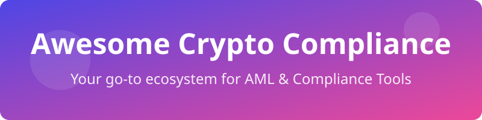

# Awesome Crypto Compliance 🛡️

## 🏆 Top Crypto Compliance Tools Ecosystem

**Curated List of SaaS Products & Open-Source GitHub Projects**

*Focused on Blockchain Analytics, Transaction Monitoring (KYT), Wallet Screening, Travel Rule, Sanctions/PEP Screening & AML Compliance*

**Last updated: August 2026**

This repository tracks notable **SaaS platforms** and **open-source projects** for **Crypto Compliance**. These tools help exchanges, VASPs, fintechs, and protocols perform blockchain analytics, real-time transaction monitoring (KYT), address screening, sanctions and PEP checks, Travel Rule messaging, identity verification, and broader AML risk management.

**Examples** include Chainalysis, TRM Labs, Elliptic, Notabene, Sumsub, Sardine, Persona, ComplyAdvantage, Unit21, and Hawk AI (the category leaders and widely used platforms).

**Open-source emphasis**: Full enterprise-grade blockchain intelligence (massive entity labeling and deep forensics) remains largely proprietary. This section highlights the strongest available open-source tools for sanctions/PEP screening, basic KYT/address risk, transaction monitoring rules engines, Travel Rule protocols, and self-hostable compliance workflows - valuable for teams seeking transparency, lower cost, or data sovereignty.

Contributions welcome! Open a PR to add/update entries. Keep descriptions factual and link to official sites / GitHub repos.

## 📋 Table of Contents

- [SaaS/Hosted Platforms](#saas-hosted-platforms)
- [Open-Source GitHub Projects](#open-source-github-projects)
- [How to Contribute](#how-to-contribute)
- [Disclaimer](#disclaimer)

## 🏢 SaaS/Hosted Platforms

| Product | Description | Pricing (Starting Tier) | Free Tier / Trial Limits | Company Size / Valuation |
| :--- | :--- | :--- | :--- | :--- |
| **[Chainalysis](https://www.chainalysis.com/)** | Leading blockchain analytics and compliance platform offering KYT monitoring, investigations, and risk scoring. | ~$50,000/year estimated minimum | Demo access only (no free trial) | ~$8.6B Valuation |
| **[Persona](https://withpersona.com/)** | Identity verification and compliance orchestration platform for KYC/KYB. | Essential plan starts at $250/mo | Free forever up to 500 verifications/mo | ~$1.5B Valuation |
| **[Sumsub](https://sumsub.com/)** | Identity verification and KYC/AML platform used in crypto for document and biometric checks. | $149/mo minimum (includes checks) | 14-day free trial or 50 free verifications | ~$1B Valuation |
| **[TRM Labs](https://www.trmlabs.com/)** | Risk intelligence and compliance platform with real-time transaction monitoring and wallet screening. | ~$40,000/year estimated minimum | Free for Law Enforcement only (TRM Deconflict) | ~$600M Valuation |
| **[Elliptic](https://www.elliptic.co/)** | Blockchain analytics and compliance suite focused on transaction screening and risk management. | ~$40,000/year estimated minimum | Demo access only (no free trial) | ~$500M Valuation |
| **[Sardine](https://www.sardine.ai/)** | Fraud and compliance platform combining device intelligence and crypto risk. | ~$30,000/year estimated minimum | Demo access only (no free trial) | ~$500M Valuation |
| **[ComplyAdvantage](https://complyadvantage.com/)** | AML screening platform covering sanctions, PEPs, and transaction monitoring. | Starter plan begins at $99/mo | 12-month free access for eligible startups | ~$500M Valuation |
| **[Unit21](https://unit21.ai/)** | No-code transaction monitoring and case management platform. | ~$33,000/year estimated minimum | Demo access only (no free trial) | ~$300M Valuation |
| **[Hawk AI](https://hawk.ai/)** | AI-powered transaction monitoring and AML platform. | ~$30,000/year estimated minimum | Demo access only (no free trial) | ~$100M Valuation |
| **[Crystal (Bitfury)](https://crystalblockchain.com/)** | Blockchain analytics and compliance provider. | ~$20,000/year estimated minimum | Free for academic institutions only | ~$100M Valuation |
| **[Merkle Science](https://www.merklescience.com/)** | Blockchain analytics and compliance provider. | ~$20,000/year estimated minimum | Demo access only (no free trial) | ~$100M Valuation |
| **[Notabene](https://notabene.id/)** | Specialized Travel Rule compliance platform for VASP data exchange. | Sunrise plan starts at $0/mo | Free forever up to $10,000 USD outgoing monthly | ~$50M Valuation |
| **[Scorechain](https://www.scorechain.com/)** | Blockchain analytics and compliance provider. | ~$500/mo estimated minimum | Free Sanctions API (100 req/hr) & 5 free AI reports | ~$15M Valuation |
| **[FreezeRadar](https://freezeradar.com/)** | Wallet screening for freezeable stablecoins: checks addresses for USDT/USDC/PAXG/XAUt issuer blacklist (freeze) status and sanctions exposure, with a live freeze/release feed. | Pro from $4.9/mo | Free public address checks | Early-stage startup |

## 💻 Open-Source GitHub Projects

- **[OpenSanctions](https://github.com/opensanctions/opensanctions)**   
  Open database of international sanctions, PEPs, and persons of interest with a powerful matching API.

- **[yente](https://github.com/opensanctions/yente)**   
  Open source data matching API for OpenSanctions.

- **[0xB10C OFAC lists](https://github.com/0xB10C/ofac-sanctioned-digital-currency-addresses)**   
  Community-maintained lists of sanctioned cryptocurrency addresses.

- **[Tornado Cash Compliance](https://github.com/tornado-cash/compliance-tool)**   
  Compliance tool for Tornado Cash to prove source of funds.

- **[AMLClaw](https://github.com/amlclaw/amlclaw.com)**   
  Open-source self-hostable crypto AML screening platform.

- **[Osprey](https://github.com/opensource-finance/osprey)**   
  Lightweight open-source transaction monitoring engine (single Go binary) using CEL rules.

- **[Marble](https://github.com/checkmarble/marble)**   
  Open-source real-time decision engine for fraud and AML transaction monitoring, screening, and case investigation. Flexible alternative to proprietary monitoring platforms with self-hosting support.

- **[Jube](https://github.com/jube-home/aml-fraud-transaction-monitoring)**   
  Open-source (AGPLv3) AML and fraud detection platform combining rule-based logic, machine learning risk scoring, real-time monitoring, and case management.

- **Wallet Attribution Datasets**   
  Aggregated open datasets of labeled addresses (exchanges, mixers, scams, bridges) useful for basic risk enrichment.

- **Travel Rule Open Standards**   
  **TRP (Travel Rule Protocol)** and related open messaging standards maintained by industry associations for decentralized or low-cost VASP-to-VASP data exchange.

- **zk-Travel Rule experiments**   
  Emerging open projects exploring zero-knowledge proofs for Travel Rule compliance without sharing raw PII.

- **FinCrimeRadar / TrustBlocks-style tools**   
  Free or open screening interfaces and educational platforms powered by OpenSanctions and public data for sanctions, PEP, and basic crypto address checks.

### Additional Strong Open-Source Options

- Rules engines and decisioning frameworks that can be wired to on-chain data for custom KYT.
- Blockchain explorers and indexing tools (Mempool.space, etc.) used as free data sources for basic analysis.
- OpenAML / FINOS academic and research projects focused on on-chain AML detection models.
- Custom screening scripts and batch tools built on public OFAC lists + RPC/node data.
- Integration of open sanctions data with open CRMs or case management systems.

**Frameworks for building custom systems**: Combine **OpenSanctions + yente** for name/address screening, **AMLClaw** or **Marble/Osprey** for transaction monitoring and case workflows, public address attribution datasets for enrichment, and open Travel Rule protocols (TRP) for messaging - creating a transparent, self-hosted compliance layer that can be augmented with commercial analytics where deeper entity intelligence is required.

## 🤝 How to Contribute

1. Fork the repo.

2. Add/edit entries in `README.md` (follow existing format).

3. Include: name, link, 1-2 sentence description, and whether it's SaaS or open-source.

4. Submit PR with a short explanation.

Star the repo if you find it useful!

## ⚠️ Disclaimer

- This is a **community-curated** list - not exhaustive and not an endorsement.

- Crypto compliance tools must be evaluated against specific regulatory requirements (FATF Travel Rule, local AML laws, sanctions regimes). Open-source tools typically provide screening and monitoring building blocks but may lack the extensive proprietary entity graphs and court-tested forensics of commercial platforms.

- Always maintain proper audit trails, data protection, and legal review when implementing compliance systems. Self-hosted solutions require ongoing maintenance of sanctions lists and rules.

---

**Made for compliance officers, VASPs, crypto exchanges, fintech risk teams, and anyone seeking more transparent and controllable crypto AML infrastructure.**

Let's make sanctions screening, transaction monitoring, and Travel Rule compliance more open, auditable, and accessible.

## ⭐ Star History

